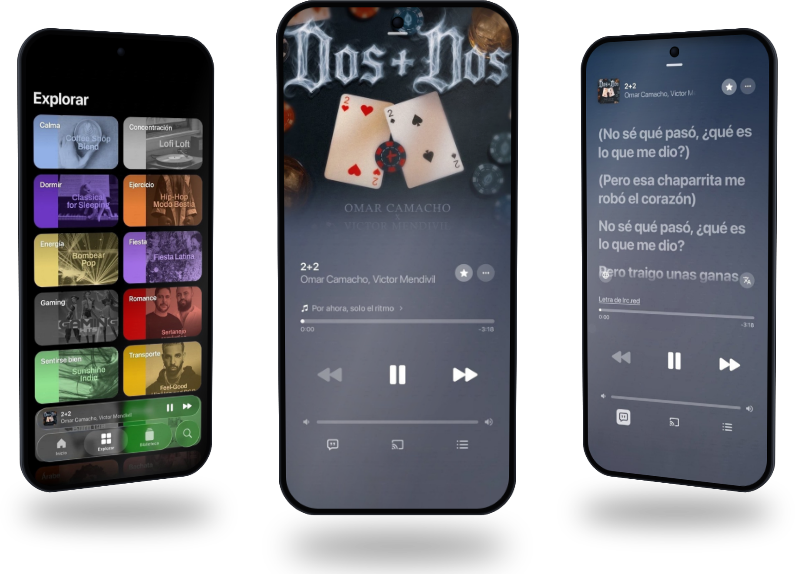
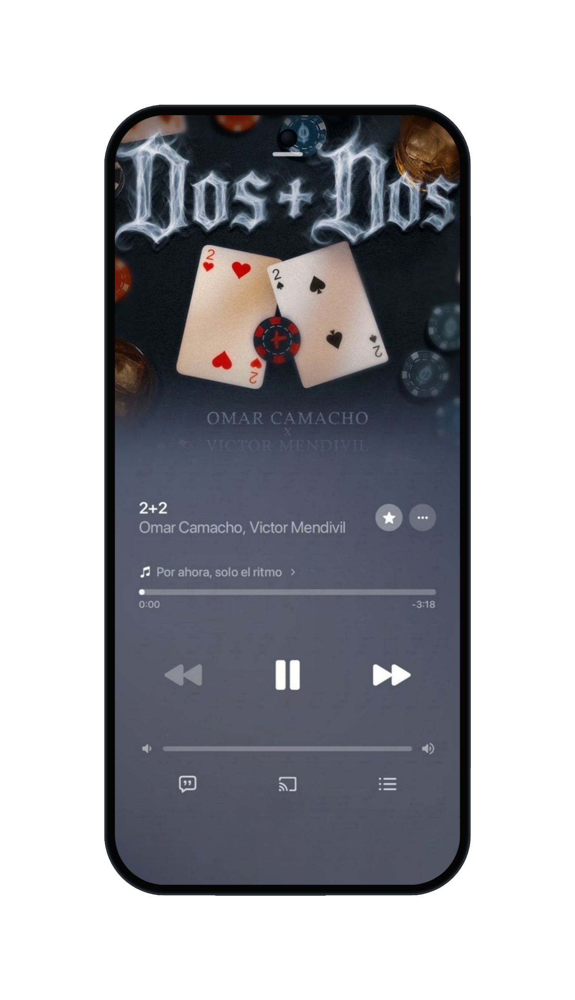
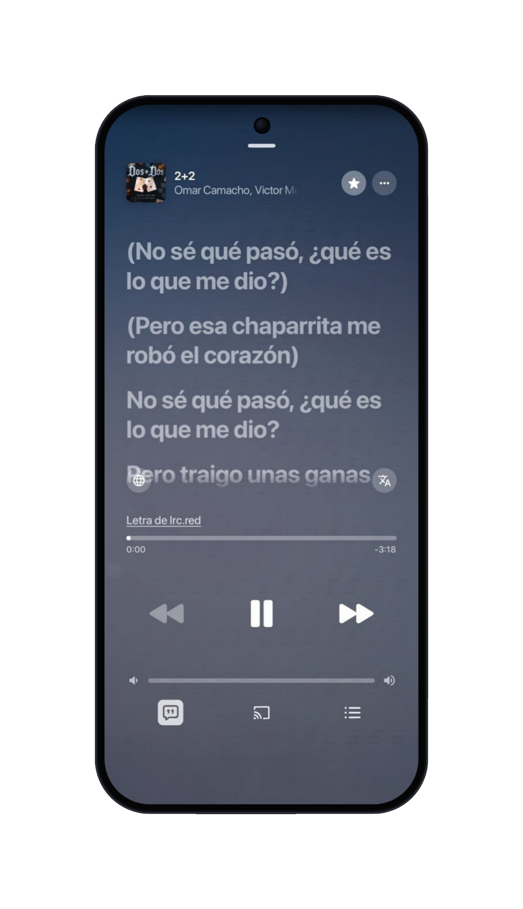
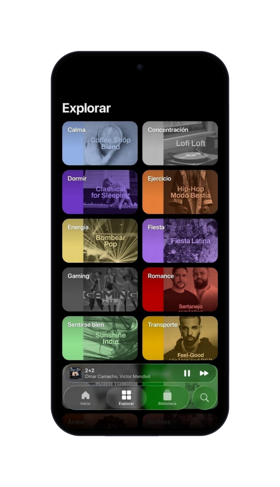

 
 

# BitChord

### Aesthetic YouTube Music Client

 

 

[**Download**](#download) · [**Features**](#features) · [**Contributing**](#contributing) · [**Support**](#support) · [**Disclaimer**](#disclaimer)

 

> [!IMPORTANT]
> BitChord is not affiliated with, endorsed by, or connected to YouTube or Google in any way. Use it at your own discretion.

---

<h1>Features</h1>

<table>
  <tr>
    <td width="50%" valign="top">

#### Playback
- **Search, browse and play** anything available on YouTube Music.
- **Hi-Res lossless audio** — FLAC/ALAC from a configured module source, with YouTube Music as fallback.
- **Gapless playback with true crossfade**, adjustable 0–12s.
- **Automix [Beta]** — DJ-style transitions with beat-matching and tempo-stretching.
- **Offline downloads** — save tracks with embedded metadata.
- **Local music library** integration.
- **Background playback** via a proper foreground media session.
- **Apple-like lyrics animation** — credit to [binimum](https://github.com/binimum/am-lyrics).

#### Connectivity & Accounts
- **Sign in with your Google account** for personalized content.
- **Spotify integration** — connect your account to play your playlists and Liked Songs.
- **Discord Rich Presence** — in-app login, live track/artist/album and progress.
- **Scrobbling** to Last.fm and ListenBrainz.
- **Pluggable sources** — add, edit, test and health-check module sources.

    </td>
    <td width="50%" valign="top">

#### Experience
- **Animated album canvas** — motion artwork on the now-playing screen.
- **Word-synced lyrics** — word/syllable-level highlighting from multiple sources.
- **Lyrics providers** — credit to [lrc.red](https://lrc.red), [BiniLyrics](https://github.com/binimum), [BetterLyrics](https://github.com/better-lyrics/better-lyrics), [PaxSenix](https://lyrics.paxsenix.org), [LyricsPlus](https://github.com/ibratabian17/YouLyPlus), [SimpMusic](https://github.com/maxrave-dev/SimpMusic), [Unison](https://unison.boidu.dev), [Megalobiz](https://www.megalobiz.com), [KuGou](https://www.kugou.com), [LRCLIB](https://lrclib.net), [Musixmatch](https://www.musixmatch.com) and [Genius](https://genius.com).
- **Dynamic, artwork-driven theming** — Material palette extracted from album art.
- **Frosted-glass UI** — Telegram-style translucent bars via Haze, Material 3 theming.

#### Controls & Tweaks
- **Per-network audio quality** — separate quality ceilings for Wi-Fi and mobile data.
- **Playback speed control** (0.5×–2.0×) and **skip silence**.
- **Sleep timer** — fixed presets or "stop after this track".
- **System equalizer** integration.
- **Bit-perfect USB exclusive output** — sends lossless tracks to a USB DAC unchanged, at each track's own rate and bit depth. Thanks to [Mornye](https://github.com/mornyeapp/Mornye) for the reference.
- **Stats for nerds** — codec, bit depth, sample rate, and more on the now-playing screen.

    </td>
  </tr>
</table>

---

<h1>Download</h1>

Grab the latest signed APK from the [Releases](https://github.com/kushagrasinghx/BitChord/releases) page. Sideloading requires enabling "Install unknown apps" for whichever app you download it with.

---

<h1>Contributing</h1>

We welcome contributions to BitChord! Please review our [Contributing Guide](CONTRIBUTING.md) and [Code of Conduct](CODE_OF_CONDUCT.md) before submitting a Pull Request.

[**Contributing Guide**](CONTRIBUTING.md) · [**Code of Conduct**](CODE_OF_CONDUCT.md) · [**Maintainers**](MAINTAINERS.md) · [**Additional Docs**](ADDITIONAL.md)

### Thanks to all contributors ❤

---

<h1>Support</h1>

BitChord is free and always will be — if it's earned a spot in your rotation, you can chip in here:

 

---

<h1>Disclaimer & Legal Notice</h1>

BitChord is an independent, community-driven third-party audio player and client. It is **not** associated with Google LLC, YouTube Music, Deezer, Telegram, or any of their parent companies.

* **No Media Hosting:** BitChord does not host, upload, or store copyrighted music files. It operates strictly as an interface to scan local device storage or stream media directly from public, public-facing, or user-authenticated APIs.
* **Fair Use & API Usage:** This software is created solely for personal research, educational, and fair-use purposes. The user is entirely responsible for ensuring their usage aligns with their local copyright laws and YouTube Terms of Service.
* **No Ad-Blocking Guarantee:** While BitChord focuses on providing a clean listening environment, it does not guarantee permanent bypasses or modifications to commercial third-party platform conditions.
* **Copyleft:** BitChord is free software under the GPLv3. The license does not let anyone forbid others from selling or redistributing copies, but any distribution must come with the Corresponding Source under the same license.

---

<h1>License</h1>

This project is licensed under the **GNU General Public License v3.0 (GPLv3)**. See the [LICENSE](LICENSE) file for details.

 
 Bitchord

Un reproductor musical estético basado en YouTube Music

 ""Última versión" (https://img.shields.io/github/v/release/kushagrasinghx/BitChord?style=for-the-badge&labelColor=0d1117)" (https://github.com/kushagrasinghx/BitChord/releases)
""Licencia" (https://img.shields.io/github/license/kushagrasinghx/BitChord?style=for-the-badge&labelColor=0d1117)" (LICENSE)
""Descargas" (https://img.shields.io/github/downloads/kushagrasinghx/BitChord/total?style=for-the-badge&labelColor=0d1117)" (https://github.com/kushagrasinghx/BitChord/releases)

 "Descargar" (#descargar) · "Características" (#caracteristicas) · "Experiencia visual" (#experiencia-visual) · "Aviso legal" (#aviso-legal)

«[!IMPORTANT]
Bitchord es un proyecto independiente y no está afiliado, respaldado ni relacionado oficialmente con YouTube o Google. Utilízalo bajo tu propia responsabilidad.»

---

<h1>Características</h1><table>
  <tr>
    <td width="50%" valign="top">Reproducción

- Buscar, explorar y reproducir contenido disponible en YouTube Music.
- Audio Hi-Res sin pérdida — FLAC/ALAC desde una fuente de módulos configurada, con YouTube Music como alternativa.
- Reproducción sin interrupciones con fundido cruzado ajustable de 0 a 12 segundos.
- Automix [Beta] — transiciones al estilo DJ con sincronización de ritmos y ajuste de tempo.
- Descargas sin conexión — guarda canciones con sus metadatos.
- Integración con la biblioteca musical local.
- Reproducción en segundo plano mediante una sesión multimedia del sistema.
- Animaciones de letras al estilo Apple — créditos a "binimum" (https://github.com/binimum/am-lyrics).

Conectividad y cuentas

- Inicio de sesión con Google para obtener contenido personalizado.

- Integración con Spotify — conecta tu cuenta para reproducir tus listas y canciones favoritas.

- Discord Rich Presence — inicio de sesión desde la aplicación, información de canciones, artistas, álbumes y progreso.

- Scrobbling compatible con Last.fm y ListenBrainz.

- Fuentes configurables — agrega, edita, prueba y verifica fuentes mediante módulos.
  
    </td>
  <td width="50%" valign="top">

Experiencia

- Portadas de álbumes animadas — ilustraciones con movimiento en la pantalla de reproducción.
- Letras sincronizadas — resaltado de palabras y sílabas mediante distintas fuentes.
- Proveedores de letras — créditos a "lrc.red" (https://lrc.red), "BiniLyrics" (https://github.com/binimum), "BetterLyrics" (https://github.com/better-lyrics/better-lyrics), "PaxSenix" (https://lyrics.paxsenix.org), "LyricsPlus" (https://github.com/ibratabian17/YouLyPlus), "SimpMusic" (https://github.com/maxrave-dev/SimpMusic), "Unison" (https://unison.boidu.dev), "Megalobiz" (https://www.megalobiz.com), "KuGou" (https://www.kugou.com), "LRCLIB" (https://lrclib.net), "Musixmatch" (https://www.musixmatch.com) y "Genius" (https://genius.com).
- Temas dinámicos — colores extraídos de las portadas de los álbumes.
- Interfaz de cristal esmerilado — barras translúcidas al estilo Telegram mediante Haze y temas Material 3.

Controles y ajustes

- Calidad de audio por conexión — límites de calidad independientes para Wi-Fi y datos móviles.

- Control de velocidad (0.5×–2.0×) y función para omitir silencios.

- Temporizador de apagado — tiempos predeterminados o detener después de la canción actual.

- Integración con el ecualizador del sistema.

- Salida USB exclusiva Bit-Perfect — envía pistas sin pérdida a un DAC USB sin modificar su frecuencia de muestreo ni profundidad de bits. Gracias a "Mornye" (https://github.com/mornyeapp/Mornye) por la referencia.

- Estadísticas avanzadas — códec, profundidad de bits, frecuencia de muestreo y más información en la pantalla de reproducción.
  
    </td>
</tr>

</table>
---

<h1>Experiencia visual</h1>Descubre la interfaz de Bitchord y sus principales apartados.

Reproductor

Letras

Explorar

---

<h1>Descargar</h1>

Descarga la versión APK más reciente desde el apartado de "Versiones" (https://github.com/kushagrasinghx/BitChord/releases).

Para instalar el APK, es posible que debas habilitar el permiso Instalar aplicaciones desconocidas para la aplicación desde la que realizas la descarga.

---

<h1>Aviso legal y condiciones</h1>Bitchord es un reproductor de audio y cliente independiente. No está asociado oficialmente con Google LLC, YouTube Music, Deezer, Telegram ni ninguna de sus empresas matrices.

* Sin alojamiento de contenido multimedia: Bitchord no aloja, sube ni almacena archivos de música protegidos por derechos de autor. Funciona como una interfaz para explorar el almacenamiento local del dispositivo o reproducir contenido mediante API públicas o autenticadas por el usuario.
* Uso legítimo y API: Este software está destinado a fines personales, educativos y de investigación. El usuario es responsable de asegurarse de que su utilización cumpla con las leyes locales de derechos de autor y las condiciones de servicio de las plataformas correspondientes.
* Sin garantía de bloqueo de anuncios: Bitchord busca ofrecer una experiencia de reproducción limpia, pero no garantiza la eliminación permanente de anuncios ni modificaciones de las condiciones de plataformas externas.
* Copyleft: Este software se distribuye bajo la licencia GPLv3. La licencia permite modificar, vender y redistribuir el software, siempre que se respeten sus condiciones, incluida la disponibilidad del código fuente correspondiente bajo la misma licencia.

---

<h1>Licencia</h1>Este proyecto está distribuido bajo la licencia GNU General Public License v3.0 (GPLv3).

Consulta el archivo "LICENSE" (LICENSE) para conocer todos los detalles.

